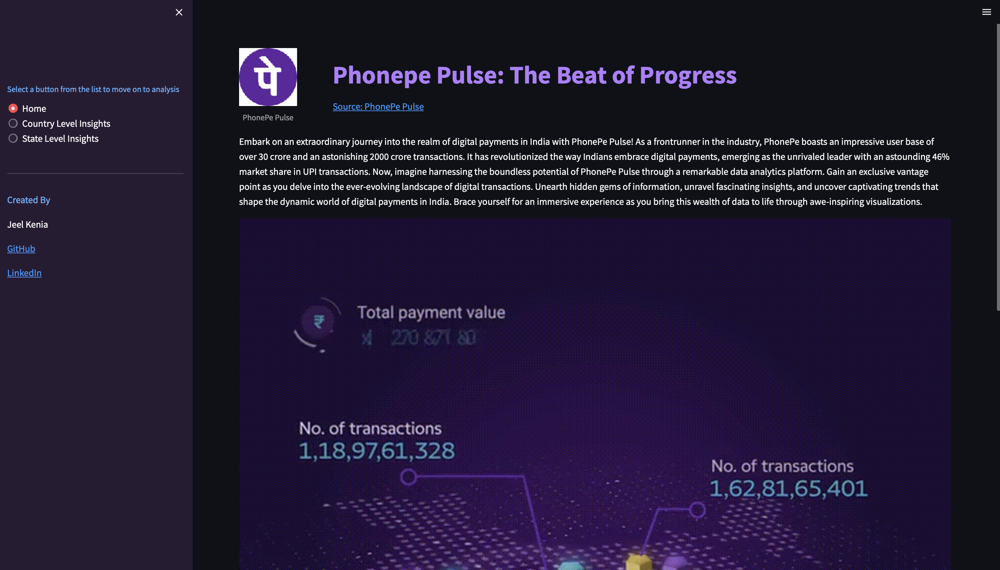
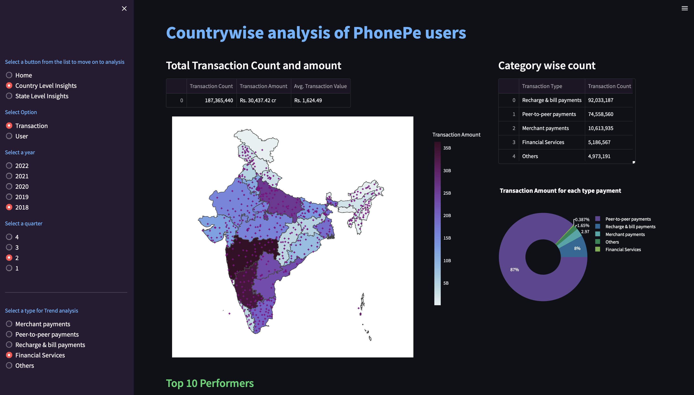
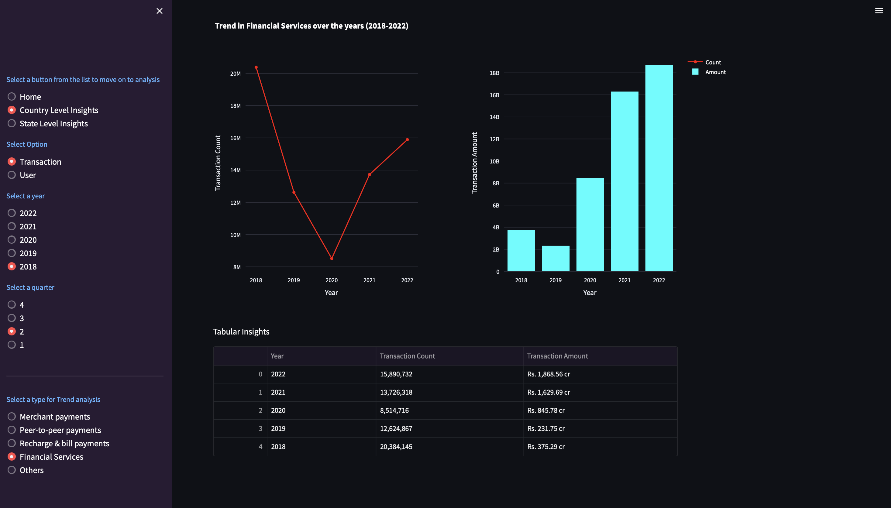
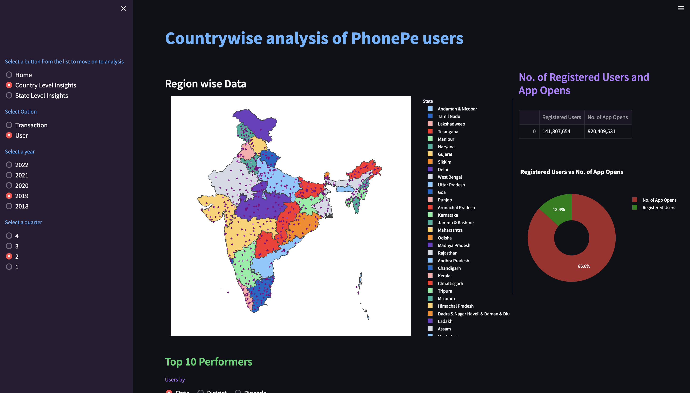
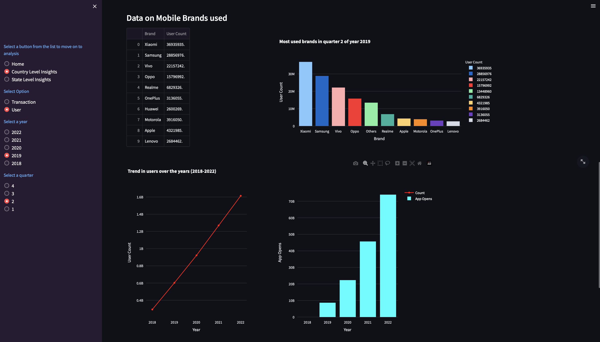
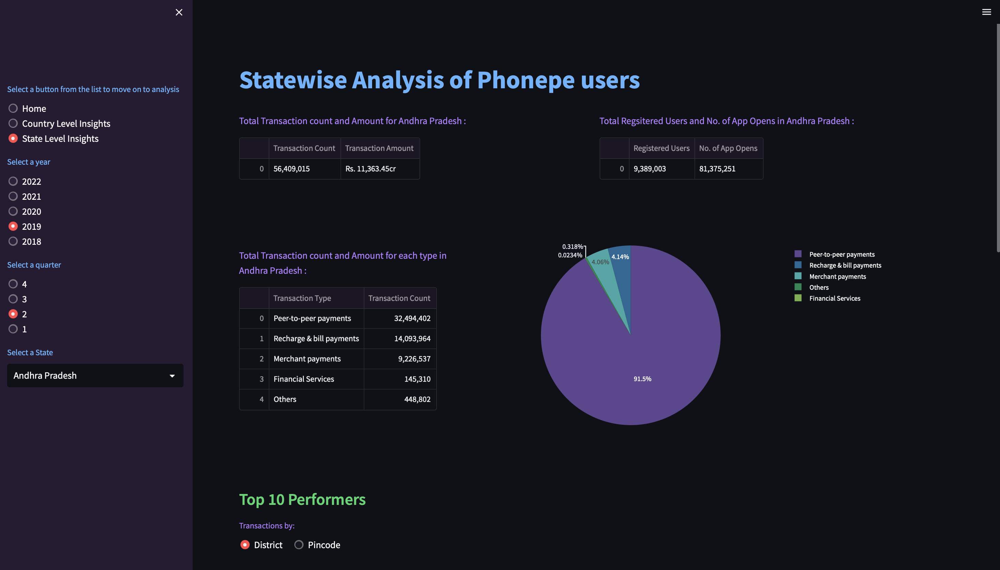
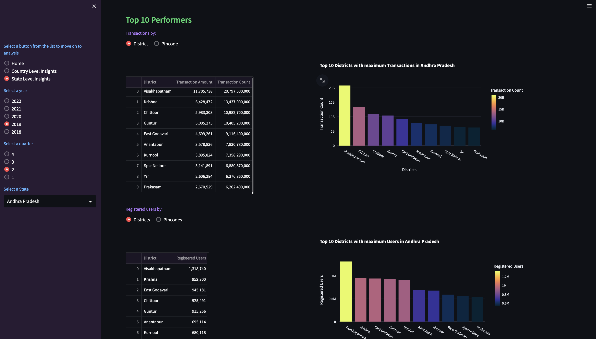

# PhonePe Pulse Data Visualization & Analytics

## Table of Contents
* [Introduction](#introduction)
* [Technologies Used](#technologies-used)
* [Process Flow](#process-flow)
* [Application Flow](#application-flow)
* [Setup & Installation](#setup--installation)
* [License](#license)
* [Conclusion](#conclusion)

---

## Introduction
* **PhonePe Pulse** provides deep visibility into India's digital payments ecosystem. With over 30 crore registered users, 2,000+ crore transactions, and a ~46% UPI market share, PhonePe represents the largest digital payments network in India.
* This interactive analytics dashboard transforms raw PhonePe Pulse transaction and user metrics into visual insights—allowing users to slice payment trends across states, quarters, and transaction categories.



> **Disclaimer:** Dataset covers transaction and user records from **2018 to 2022**.

---

## Technologies Used
* **Python:** Core programming language used for data extraction, transformation, and backend logic.
* **MySQL:** Relational database used to store structured transaction and user tables for fast querying.
* **Streamlit:** Interactive web framework powering the dashboard UI and dynamic filter controls.
* **Pandas:** Data manipulation library used to clean, aggregate, and structure raw JSON records into tabular DataFrames.
* **Plotly:** Visualization library used to build interactive geographical maps, bar charts, and trend plots.

---

## Process Flow

### 1. ETL Pipeline
* **Extract:** Cloned the open-source [PhonePe Pulse GitHub repository](https://github.com/PhonePe/pulse) containing aggregated JSON datasets.
* **Transform:** Parsed nested directory structures and JSON payloads using Python and Pandas to normalize transaction counts, amounts, and user registration metrics into clean DataFrames.
* **Load:** Designed a normalized MySQL database schema and bulk-inserted the transformed records for structured querying.

### 2. Data Analysis & Visualization
* **Querying:** Executed parameterized SQL queries from the application layer based on user-selected filters.
* **Visualization:** Rendered interactive geospatial maps, state-wise rankings, and category breakdowns in Streamlit using Plotly.

---

## Application Flow
1. **Home Page:** Displays an overview of the PhonePe Pulse ecosystem and provides navigation to the analytics modules.

   

2. **Module Selection:** Choose between **Transaction Analysis** and **User Analysis** depending on the metrics you want to explore.
3. **Interactive Filtering:** Filter insights dynamically by **Type**, **Year**, **Quarter**, and **State** to inspect granular charts and summary tables.

   
   
   
   
   
   

---

## Setup & Installation
1. Clone the repository and navigate to the project directory:
   ```bash
   git clone <your-repo-url>
   cd PhonePe-Data-Visualisation
